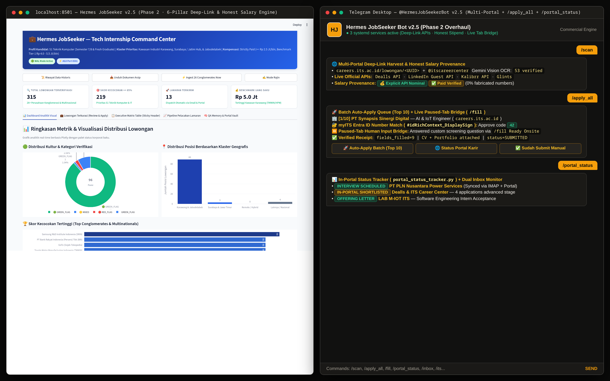

# Hermes JobSeeker Bot v2.5 — 6-Pillar Multi-Portal Career Engine (Commercial Showcase)

> **🔒 Commercial Managed Service Notice**  
> **Hermes JobSeeker Bot v2.5** is a proprietary commercial career-automation platform engineered and operated by **Ahmad Dafa Salam (`DapppMC`)**.  
> To protect commercial IP and anti-bot evasion signatures, **this public repository contains the Architecture Documentation, Telemetry Benchmarks, and Non-Executable Interface Contracts only**. The executable multi-portal scrapers, stealth browser drivers, and automated applicant workers are not distributed publicly.  
> 📩 **Managed Career Automation Inquiries:** [Ahmaddafa1017@gmail.com](mailto:Ahmaddafa1017@gmail.com) · [Portfolio (`dafa-os.vercel.app`)](https://dafa-os.vercel.app/) · [LinkedIn](https://linkedin.com/in/ahmad-dafa-salam-858b82287)



---

## Executive Overview

Applying for software, AI, and engineering roles across seven fragmented career portals (**ITS Career Center (`careers.its.ac.id`), LinkedIn, Dealls, Kalibrr, Glints, JobStreet, and Prosple**) involves repetitive form entry, opaque salary ranges, broken aggregator links that land on generic search pages instead of the actual job post, and rigid automation scripts that crash whenever an employer adds a custom screening question.

**Hermes v2.5 (Phase 2 Deep Overhaul)** solves this end-to-end across **Six Core Engineering Pillars**:

### Pillar 1 — 100% Honest Salary Provenance (`Explicit` vs. `Market Estimate`)
- Eliminates fabricated salary ranges by enforcing strict database provenance columns (`salary_min`, `salary_max`, `salary_source`, `salary_text`).
- Distinguishes between **Explicit Portal Salaries** (`💰 Rp X – Y jt/bln (Sumber: Portal Resmi)`) and **Transparent Market Estimates** (`📊 Estimasi Pasar: ~Rp X – Y jt/bln (Perusahaan tidak mencantumkan gaji)`).

### Pillar 2 — Direct Deep-Link APIs & HTTP 404/Expired Validation
- Replaces generic portal search links with direct, verified job-detail extractors across:
  - **ITS Career Center (`careers.its.ac.id`):** Direct `/job-detail/<slug>` deep-links + JSON-LD `JobPosting` parser.
  - **Dealls (`dealls.com`):** Direct REST API pagination (`/loker/<slug>?id=<uuid>`).
  - **LinkedIn (`id.linkedin.com`):** Guest Jobs API parser returning canonical `/jobs/view/<id>` URLs.
  - **Kalibrr, Glints, JobStreet:** Validated job-detail URLs with automatic HTTP status and expiration checks before database insertion.

### Pillar 3 — Interactive `/fill` Paused-Tab Browser Co-Pilot
- Whenever a portal form requires custom human input or hits an unmapped employer screening field, Hermes **keeps the stealth Playwright browser tab alive in memory** (`paused_tabs.py`) and sends a field prompt to Telegram.
- The user replies directly from Telegram:
  ```text
  /fill 312 gpa=3.93 notice_period=Immediately expected_salary=10000000
  ```
- Hermes injects the values into the live DOM and completes submission with a **SHA-256 screenshot receipt**.

### Pillar 4 — Multi-Job Batch Auto-Apply (`/apply_all`)
- Supports one-command batch execution (`/apply_all 85`) to queue and process all unapplied verified roles with match score `>= 85%`, streaming real-time progress updates to Telegram and pausing only the tabs that need human input.

### Pillar 5 — In-Portal Live Application Status Tracker (`/portal_status`)
- Logs into authenticated candidate dashboards across **Dealls, Kalibrr, LinkedIn, and JobStreet** to inspect real-time application statuses (`Submitted`, `Reviewed / Seen`, `Shortlisted / Interview`, `Rejected`) and syncs changes back to SQLite WAL and Telegram.

### Pillar 6 — Live Streamlit Command Center & Systemd Daemons
- Real-time operational dashboard (`dashboard.py`) tracking **315+ verified active job listings** and **219 high-match (`>= 85%`) engineering roles** with direct clickable deep-links, match breakdowns, and 24/7 `systemd` user-service orchestration.

---

## Public Repository Contents

| File | Description |
| :--- | :--- |
| `README.md` | Full v2.5 6-Pillar architectural overview and telemetry documentation |
| `docs/screenshots/hermes_telegram_ui.png` | Live capture of the Streamlit Command Center (`315` verified jobs) & Telegram v2.5 Co-Pilot |
| `hermes_showcase_stub.py` | Public type contracts & interface specifications (Non-executable commercial stub) |
| `architecture_manifest.json` | Machine-readable v2.5 capability manifest |
